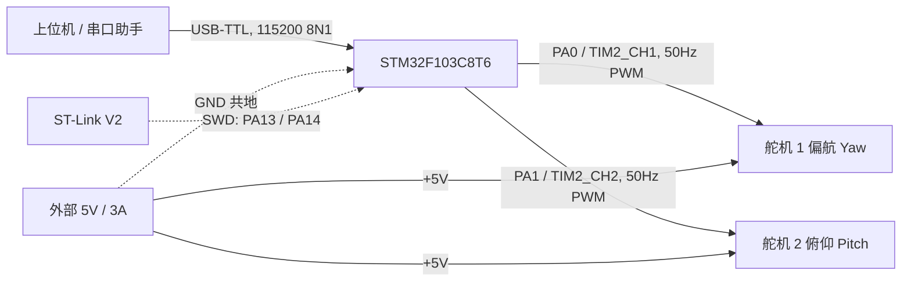
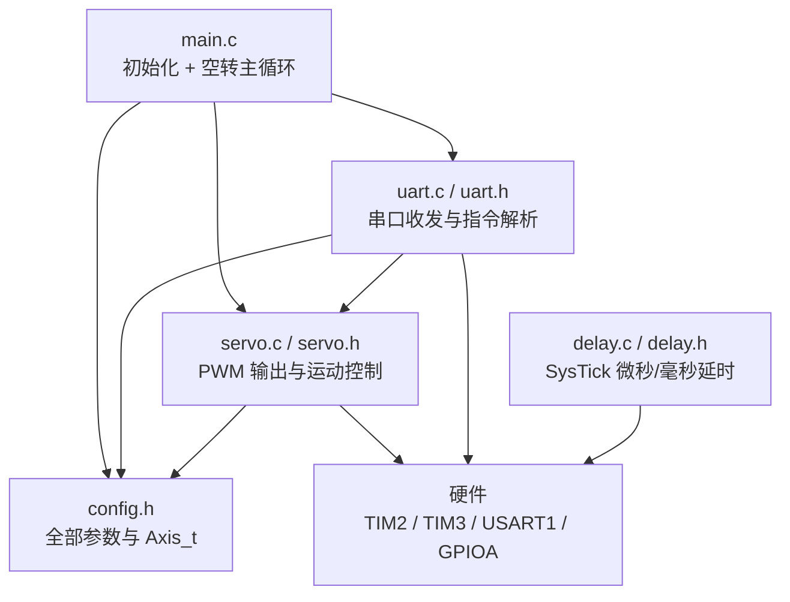
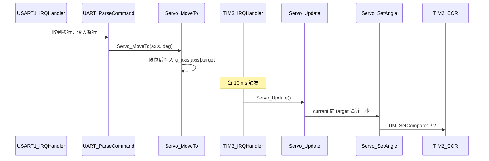

# 架构说明

二维云台（2-Axis Pan-Tilt Gimbal）的软硬件结构、模块划分与调用关系。

## 1. 一句话定位

STM32F103C8T6 输出两路 50 Hz PWM 驱动两个 SG90 舵机，通过 UART 接收角度指令，
用定时器中断逐步推进角度，实现平滑且不阻塞主循环的双轴控制。

## 2. 硬件架构

三条硬性约束：

- 舵机**独立供电**，不取自 MCU 的 5V / 3V3（电流不够会拉复位）
- 外部电源与 MCU **必须共地**（否则信号没有共同参考）
- PA13 / PA14 被 SWD 占用，**不可作普通 IO**

## 3. 软件分层

## 4. 模块职责

| 文件 | 职责 | 边界（不该做什么） |
|---|---|---|
| `config.h` | 脉宽范围、轴编号、安全角度、串口参数、`Axis_t` 定义 | 不放函数实现 |
| `servo.c/h` | TIM2 双通道初始化、角度→脉宽、限位、分步推进 | 不解析字符串、不碰串口 |
| `uart.c/h` | USART1 初始化、收发、按换行分帧、指令解析 | 不直接操作 TIM2 寄存器 |
| `delay.c/h` | 基于 SysTick 的 `Delay_us` / `Delay_ms` | 不依赖其他业务模块 |
| `main.c` | 调用各模块初始化、配置 TIM3 中断、空转 | 不写具体业务实现 |

## 5. 外设与定时器分配

| 外设 | 用途 | 关键参数 |
|---|---|---|
| TIM2 CH1 / CH2 | 两路 50 Hz PWM | `PSC=71`、`ARR=19999`、`CCR=脉宽(μs)` |
| TIM3 | 10 ms 周期中断，推进运动 | `PSC=7199`、`ARR=99` |
| USART1 | 指令接收与回复 | 115200，8N1，RXNE 中断 |
| SysTick | 延时 | HCLK 72 MHz |

**为什么 TIM2 和 TIM3 必须分开**：TIM2 专职产生 20 ms 周期的 PWM，这个周期不能被动；
TIM3 只做 10 ms 节拍。如果合并成一个定时器，调整推进速度就会破坏 PWM 频率。

## 6. 调用关系

## 7. 关键设计决策

| 决策 | 理由 |
|---|---|
| 两轴共用 TIM2 的两个通道 | 周期天然同步，脉宽各自独立，代码最简 |
| 运动由 TIM3 中断推进，而非 `Delay` 阻塞 | 转动期间仍能响应串口，指令可中途改变目标 |
| 参数集中在 `config.h` + `Axis_t` 数组 | 增加第三个轴只需扩数组，不必改多处 |
| 中断只做"收字节 / 走一步"，不做耗时操作 | 避免阻塞其他中断与主循环 |
| 限位放在唯一入口 `Servo_SetAngle` | 任何调用都绕不过去，堵死所有后门 |
