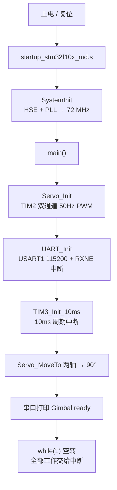

# 执行流程

从"上电"到"舵机转到目标角度"的完整链路。

## 1. 启动流程

**关键点**：`SystemInit()` 在进入 `main()` **之前**由启动文件调用，配好 72 MHz。
所以 `PSC = 71` 这个前提从一开始就成立。如果时钟没配到 72 MHz，所有周期都会等比例变长。

## 2. 一次指令的完整旅程

以串口发送 `A90` + 回车为例：

| 步骤 | 位置 | 发生了什么 |
|---|---|---|
| 1 | USART1 | 收到字节 `'A'`，置位 RXNE，触发中断 |
| 2 | `USART1_IRQHandler` | 读 DR（自动清标志），存入 `s_rxBuf[0]` |
| 3 | 同上 | 依次收到 `'9'`、`'0'` 并存入 |
| 4 | 同上 | 收到 `'\r'`，判定一帧结束，补 `'\0'` |
| 5 | `UART_ParseCommand` | 首字符 `'A'` → `axis = AXIS_YAW` |
| 6 | 同上 | `atoi("90")` → 90，范围检查通过 |
| 7 | `Servo_MoveTo` | 90 在 10~170 内，写入 `g_axis[1].target = 90`，**立即返回** |
| 8 | 同上 | 回 `OK` |
| 9 | TIM3 中断（每 10 ms） | `Servo_Update` 让 `current` 向 90 逼近 1 度 |
| 10 | `Servo_SetAngle` | 角度 → 脉宽 → 写 CCR1 |
| 11 | TIM2 硬件 | 下一个 PWM 周期用新脉宽输出 |
| 12 | 舵机 | 转到新位置 |

**第 7 步与第 9 步之间的分工，就是"非阻塞"的全部含义**：
`Servo_MoveTo` 只是"记下目标"并立刻返回，真正的移动由之后每个 10 ms 中断完成。
所以在这期间再发一条指令，目标会被立即覆盖，舵机中途掉头。

## 3. 三层时间节奏

| 周期 | 产生者 | 做什么 | 停掉的后果 |
|---|---|---|---|
| **20 ms（50 Hz）** | TIM2 硬件 | 持续输出 PWM，舵机靠它保持位置 | 舵机松力 |
| **10 ms（100 Hz）** | TIM3 中断 | 每轴前进一步（1°/步），约 100°/秒 | 角度不再变化 |
| **不定时** | USART1 中断 | 收到指令立刻改目标 | 无法控制 |

三者互不阻塞。**转速由 10 ms 决定**：改成 5 ms → 约 200°/秒；改成 20 ms → 约 50°/秒。

## 4. 双轴同时运动的时序

发 `A45` 后紧跟 `B120`：

| 时刻 | 偏航 Yaw | 俯仰 Pitch |
|---|---|---|
| 0 ms | target=45，current=90 | target 仍为 90 |
| ~10 ms | target=45，current=89 | 收到指令，target=120 |
| 0~450 ms | 每 10 ms 减 1，走 45 步 | 每 10 ms 加 1，走 30 步 |
| ~300 ms | 仍在走 | **已到 120°** |
| ~450 ms | 到达 45° | 保持 120° |

两个轴在**同一个 `Servo_Update()` 循环**里各走一步，所以是同时开始、同时推进，
只是步数不同（距离不同），先到者先停。

## 5. 上电时应留意的三个行为

1. 舵机**先收到中位**（`Servo_Init` 里 CCR 初值 1500），再被 `MoveTo` 拉到 90°
2. 如果舵盘装配位置不对，上电会出现"猛拉"动作 → 回看机械装配顺序（先回中位再装舵盘）
3. 串口应在 1 秒内收到 `Gimbal ready`；收不到说明 `UART_Init` 或接线有问题
